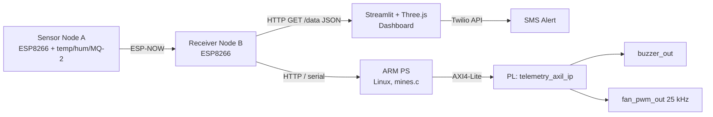

# SAFE-LINC: FPGA + ARM Mine Ventilation Telemetry & Early-Warning System

A low-cost system that monitors temperature, humidity and gas/smoke levels at underground coal mine ventilation outlets, raises a local alarm, boosts ventilation airflow, and escalates to a live dashboard and SMS.

This repository contains the **FPGA + ARM SoC implementation** (Verilog AXI4-Lite IP + Linux C application) together with the **ESP8266 wireless nodes** and the **Streamlit + Three.js dashboard** from the original Smart India Hackathon 2026 project (Problem Statement SIH26025).

> **Team:** [Member 1 Name], [Member 2 Name]
> **Contest:** [Contest Name]

---

## Table of Contents

1. [Features](#features)
2. [System Architecture](#system-architecture)
3. [Repository Structure](#repository-structure)
4. [Hardware Requirements](#hardware-requirements)
5. [FPGA IP: `telemetry_axil_ip`](#fpga-ip-telemetry_axil_ip)
6. [ARM Software: `mines.c`](#arm-software-minesc)
7. [ESP8266 Nodes](#esp8266-nodes)
8. [Dashboard & SMS Alerts](#dashboard--sms-alerts)
9. [Step-by-Step Setup](#step-by-step-setup)
10. [Testing](#testing)
11. [Limitations](#limitations)
12. [Future Work](#future-work)
13. [License](#license)

---

## Features

- **Hardware threshold detection:** temperature and MQ-2 gas limits are compared in FPGA fabric, so the alert changes in the same clock cycle the register value changes.
- **Hardware buzzer:** toggles every 100 ms while an alert is active.
- **Automatic fan boost:** 25 kHz PWM output runs at 95% duty when auto-fan is enabled and an alert is active; otherwise it follows a manual duty setting (clamped to 100%).
- **AXI4-Lite register interface** for the ARM processor (4 registers).
- **Wireless sensing:** ESP8266 nodes send `TelemetryPacket` (`temp`, `hum`, `mq2`) over ESP-NOW to a receiver that serves JSON at `/data`.
- **Non-blocking local buzzer** on the ESP8266 receiver (`millis()`, no `delay()`).
- **Live 3D dashboard** (Streamlit + Three.js) with sparkline, data stream terminal and CSV export.
- **Single-latched Twilio SMS** when temperature exceeds 40.0 °C.

## System Architecture



**Flow:**

1. Sensor nodes at ventilation outlets sample temperature, humidity and MQ-2.
2. ESP-NOW carries packets to the receiver, which exposes the latest reading at `GET /data`.
3. The ARM processor writes readings into the FPGA IP's registers; the IP evaluates breaches and drives the buzzer and fan.
4. The dashboard polls `/data`, visualizes the shaft, logs data and sends one SMS per alert event.

> ESP-NOW is specific to Espressif chips and is not native to FPGA fabric, so the ESP8266 nodes remain the wireless front end and the SoC consumes their data through the ARM PS.

## Repository Structure

Suggested layout (adjust to match your files):

```
.
├── README.md
├── fpga/
│   ├── telemetry.v            # AXI4-Lite IP (telemetry_axil_ip)
│   └── tb/                    # (add) simulation testbench
├── arm/
│   └── mines.c                # Linux C app, accesses IP via /dev/mem
├── esp8266/
│   ├── transmitter/           # Node A sketch (ESP-NOW sender)
│   └── receiver/              # Node B sketch (ESP-NOW receiver + /data server)
├── dashboard/
│   └── app.py                 # Streamlit + Three.js dashboard, Twilio SMS
├── docs/
│   ├── project_report.docx
│   └── SIH_presentation.pdf
└── LICENSE
```

## Hardware Requirements

| Component | Purpose |
|---|---|
| FPGA + ARM SoC board (e.g., Zynq-7000) | Runs the IP in PL and Linux on PS |
| 2 × ESP8266 (NodeMCU) minimum | Transmitter and receiver |
| Temperature/humidity sensor | Node A |
| MQ-2 gas sensor | Node A |
| Buzzer | ESP8266 receiver (D5 / GPIO14) and FPGA `buzzer_out` |
| Fan with PWM driver | FPGA `fan_pwm_out` (25 kHz) |

**Software:** Vivado, Arduino IDE (ESP8266 core), Python 3.9+, a Twilio account.

## FPGA IP: `telemetry_axil_ip`

### Parameters

| Parameter | Default | Description |
|---|---|---|
| `C_S_AXI_DATA_WIDTH` | 32 | AXI data width |
| `C_S_AXI_ADDR_WIDTH` | 6 | AXI address width |
| `CLK_FREQ_HZ` | 100,000,000 | AXI clock frequency (used for buzzer and PWM timing) |
| `TEMP_LIMIT_X10` | 400 | Temperature limit ×10 (40.0 °C) |
| `MQ2_LIMIT` | 700 | MQ-2 raw-value limit |

### Ports (non-AXI)

| Port | Dir | Description |
|---|---|---|
| `buzzer_out` | out | Toggles every 100 ms while `alert_active` |
| `fan_pwm_out` | out | 25 kHz PWM fan control |

### Register Map

Offsets are relative to the AXI base address assigned in Vivado.

| Offset | Name | Access | Fields |
|---|---|---|---|
| `0x00` | `REG_TEMP_HUM` | R/W | `[15:0]` temperature ×10, `[31:16]` humidity ×10 |
| `0x04` | `REG_MQ2` | R/W | `[15:0]` MQ-2 raw value |
| `0x08` | `REG_FAN_CTRL` | R/W | `[7:0]` manual fan duty (%), `[8]` auto-fan enable |
| `0x0C` | `REG_STATUS` | RO | bit 0 `alert_active`, bit 1 `temp_breach`, bit 2 `mq2_breach` |

Values are fixed-point ×10, so 42.5 °C is written as `425`.

**Reset values:** `REG_TEMP_HUM = 0x0000011D` (28.5 °C), `REG_MQ2 = 0x00000140` (320), `REG_FAN_CTRL = 0x00000123` (auto-fan on, 35% manual duty).

### Behavior

- `temp_breach = temp_x10 > TEMP_LIMIT_X10`
- `mq2_breach = mq2_raw > MQ2_LIMIT`
- `alert_active = temp_breach | mq2_breach`
- **Buzzer:** toggles every `CLK_FREQ_HZ / 10` cycles (100 ms at 100 MHz) while alert is active; forced low otherwise.
- **Fan PWM:** period `CLK_FREQ_HZ / 25000` (4,000 cycles at 100 MHz).
  - `auto_fan_en && alert_active` → 95% duty
  - otherwise → `fan_override`, clamped to 100%

### Vivado Integration

1. Create a Zynq block design and add the Zynq Processing System.
2. Add `telemetry.v` as a module reference (or package it as a custom IP).
3. Connect `s_axi_*` to the PS through AXI Interconnect, and `s_axi_aclk` / `s_axi_aresetn` to the PS clock and reset.
4. Assign an address in **Address Editor** and note it (the example uses `0x43C00000`).
5. Make `buzzer_out` and `fan_pwm_out` external and constrain them to board pins in your XDC.
6. Generate bitstream and export hardware.

## ARM Software: `mines.c`

Maps the IP into user space via `/dev/mem`, writes a test reading, and prints the status register.

```c
#define IP_BASE_ADDR 0x43C00000U   // Replace with your Vivado AXI base address
```

The example writes 42.5 °C, 50.0% humidity, MQ-2 = 350 and auto-fan enabled with a 35% manual duty. Because 425 > 400, the temperature comparator fires: the status register reads with bit 0 set, the buzzer pulses and the fan goes to 95%.

**Build and run on the board (as root):**

```bash
gcc -o mines mines.c
sudo ./mines
```

Expected output (for the example values):

```
Status register: 0x........ (alert=1)
```

> Replace the hardcoded values with live data (e.g., poll the receiver's `/data` endpoint or read a serial link, then write the registers) for real deployment.

## ESP8266 Nodes

**Transmitter (Node A)**

- Wi-Fi in station mode (`WIFI_STA`), ESP-NOW initialized as controller.
- Registers the receiver's MAC address as a peer.
- Fills `TelemetryPacket` (`temp`, `hum`, `mq2`) and calls `esp_now_send()` on a timer.

**Receiver (Node B)**

- `OnDataRecv()` copies incoming ESP-NOW payloads into `incomingData`.
- `ESP8266WebServer` on port 80, `GET /data` returns:

  ```json
  {"temp": 41.2, "humidity": 55.0, "mq2": 320}
  ```

  with `Access-Control-Allow-Origin: *`.
- Wi-Fi modes: **AP mode** (`Telemetry_Hub`, IP `192.168.4.1`) or **station mode** on an existing network (DHCP IP).
- Non-blocking buzzer on D5 (GPIO14): toggles every 100 ms with `millis()` when `temp > 40.0`, forced LOW otherwise. `delay()` is avoided so `server.handleClient()` is never blocked.

Before uploading, set the receiver MAC address in the transmitter sketch, and the Wi-Fi credentials in the receiver sketch if using station mode.

## Dashboard & SMS Alerts

`dashboard/app.py` runs two parts:

- **Background SMS worker:** daemon thread that polls `/data` every 2.0 s. A global `ALERT_SENT` latch sends one Twilio SMS when temperature first exceeds 40.0 °C and resets once it returns to 40.0 °C or below.
- **Three.js / WebGL interface:** polls `/data` every 500 ms, updates readings, appends rows for CSV export, and draws a live temperature/MQ-2 sparkline. On alert, the scene changes colour state and particle flow velocity rises from 0.35 (idle) to 1.95. Includes camera reset, wireframe toggle and a data stream terminal.

### Configuration

Do **not** commit credentials. Use environment variables or Streamlit secrets:

```bash
export TWILIO_ACCOUNT_SID="your_sid"
export TWILIO_AUTH_TOKEN="your_token"
export TWILIO_FROM_NUMBER="+1XXXXXXXXXX"
export ALERT_TO_NUMBER="+91XXXXXXXXXX"
export ESP_IP="192.168.4.1"
```

(Adjust names to match how `app.py` reads them.) Add a `.gitignore` entry for any `.env` or `secrets.toml` file.

### Install and run

```bash
pip install streamlit requests twilio
streamlit run dashboard/app.py
```

## Step-by-Step Setup

1. **Flash the receiver** sketch, open the Serial Monitor at 115200 baud, and note its IP (`192.168.4.1` in AP mode, or the DHCP address in station mode).
2. **Flash the transmitter** sketch with the receiver's MAC address.
3. **Verify `/data`:** from a machine on the same network, open `http://<IP>/data` and confirm valid JSON.
4. **Match URLs** in `app.py`: both `requests.get(...)` in `monitor_alerts_background()` and `fetch(...)` in `queryESP()` must point to that exact URL.
5. **Build the FPGA design** in Vivado and boot Linux on the ARM PS.
6. **Run `mines`** on the board to confirm register access and the buzzer/fan response.
7. **Launch Streamlit**, raise temperature above 40.0 °C, and check the buzzer pulse, the 3D alert state and a single SMS. Export the CSV when done.

## Testing

Suggested simulation cases for `telemetry_axil_ip` (reduce `CLK_FREQ_HZ` to speed up timing checks):

| Test | Stimulus | Expected |
|---|---|---|
| Reset | Assert reset | Defaults loaded, `buzzer_out = 0`, status bit 0 = 0 |
| Normal | temp = 350, MQ-2 = 320 | No alert, PWM follows manual duty |
| Temp breach | temp = 425 | Status bits 0 and 1 set, buzzer toggling, PWM 95% |
| Gas breach | MQ-2 = 800 | Status bits 0 and 2 set |
| Auto-fan off | Alert with bit 8 = 0 | Duty follows `fan_override` |
| Override clamp | `fan_override` = 150 | Duty clamped to 100% |
| Clear | Return to normal | Buzzer forced low |

## Limitations

- `mines.c` currently writes fixed test values; live data integration is left to the user.
- Thresholds are compile-time parameters; the ESP8266 and dashboard layers check temperature only, while the FPGA IP also checks MQ-2.
- `/dev/mem` requires root; a UIO or kernel driver is preferable for production.
- MQ-2 readings are raw and need calibration. Limits shown are demonstration values, not certified mining safety limits.
- Needs field testing and calibration in real mine conditions.

## Future Work

- Runtime-configurable thresholds through extra AXI registers
- Interrupt output to the PS on breach
- Tilt and micro-vibration channels with digital filtering
- ML-based anomaly detection (e.g., Isolation Forest) on the PS
- Fan tachometer feedback for closed-loop airflow
- LoRa/ESP-MESH for range, solar/battery nodes, GIS danger-zone map

## License

[Choose a license, e.g., MIT] — see `LICENSE`.

## Acknowledgements

Developed from the Smart India Hackathon 2026 project (SIH26025) by [Team Name]. References include Li & Liu (2009), *Underground coal mine monitoring with wireless sensor networks*, and Khan et al. (2022), *An efficient wireless sensor network based on the ESP-MESH protocol*, *Sustainability* 14(24), 16630.
